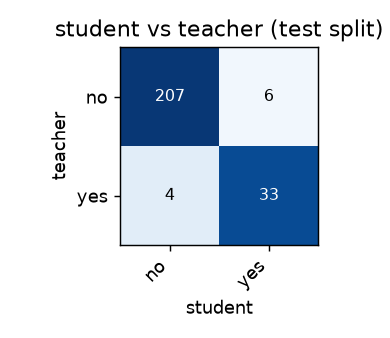
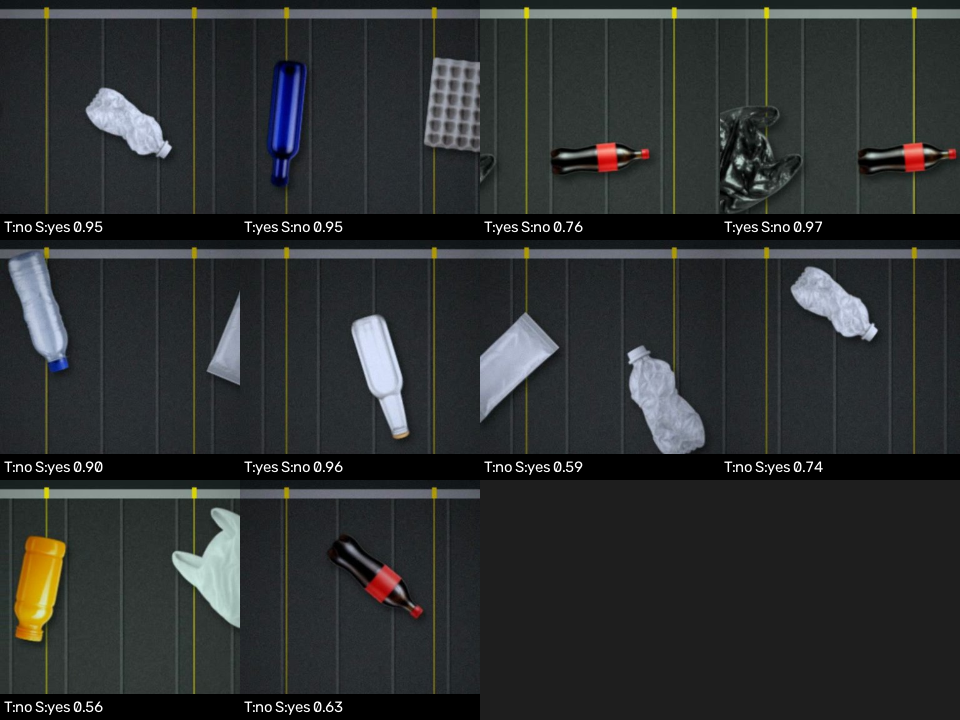

# Reflex report — `conveyor`

**Task:** Top-down camera over a recycling conveyor belt (dark rubber with vertical cleat lines). Two thin yellow lines across the belt mark the inspection zone. Mixed waste passes through: plastic bottles, glass bottles, cans, cardboard, paper, cartons and plastic bags.  
**Query:** push plastic bottles off the recycling belt  
**Classes:** no, yes  
**Backbone:** efficientnet_b0

## Student vs teacher

| | Student (Reflex) | Teacher (cloud) |
|---|---|---|
| Agreement with teacher | **96.0%** (macro-F1 0.92) | — |
| Latency p50 / p95 | **8.5 / 25.3 ms** (CPU, onnxruntime) | 346.9 / 687.6 ms (+ network) |
| Speed-up | **40.9×** | 1× |
| Size | **16.03 MB** | — |
| Cost per 1,000 frames | **$0** | $0.404 |

Test set: 250 frames, split by **episode** (no random frame split → no leakage).
Agreement on frames where the teacher was confident (≥ 0.6): 96.8%.

## Per class

| class | precision | recall | support |
|---|---|---|---|
| no | 0.98 | 0.97 | 213 |
| yes | 0.85 | 0.89 | 37 |

## Worst disagreements

| frame | teacher | student |
|---|---|---|
| ep009__00090 | no (1.00) | yes (0.95) |
| ep009__00098 | yes (0.78) | no (0.95) |
| ep003__00048 | yes (0.95) | no (0.76) |
| ep003__00050 | yes (0.72) | no (0.97) |
| ep009__00070 | no (0.68) | yes (0.90) |
| ep009__00003 | yes (0.63) | no (0.96) |
| ep009__00117 | no (1.00) | yes (0.59) |
| ep009__00081 | no (0.56) | yes (0.74) |
| ep003__00096 | no (0.69) | yes (0.56) |
| ep009__00114 | no (0.56) | yes (0.63) |

## Labels

1500 frames labelled by the teacher, 0 propagated back, 12 low-confidence (down-weighted).
