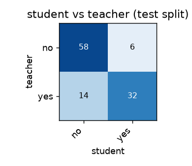
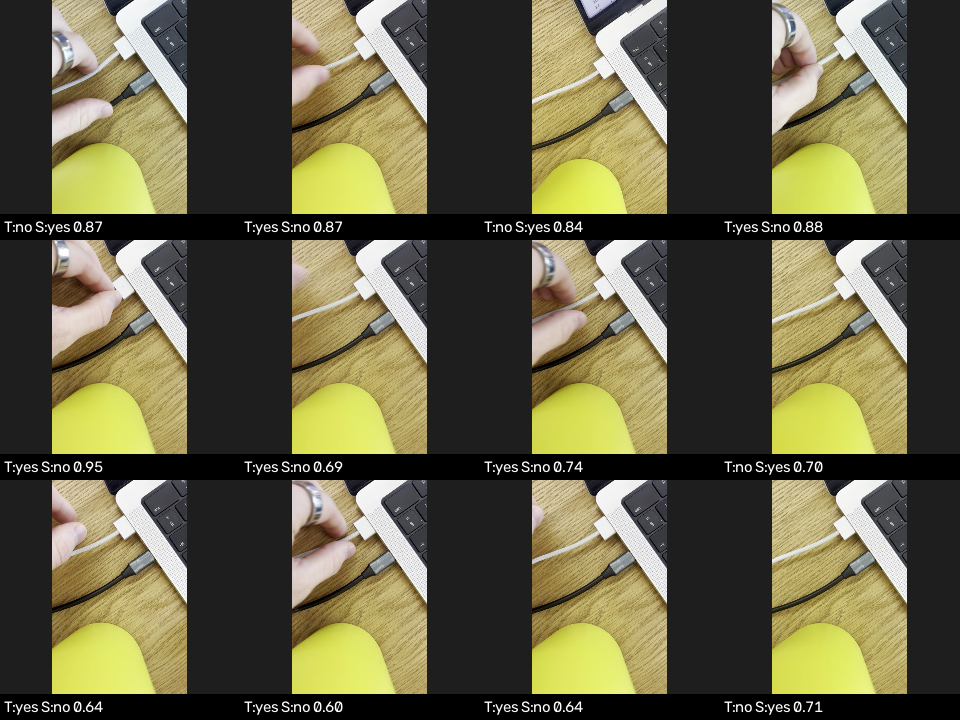

# Reflex report — `plug`

**Task:** Top-down phone view of a desk with a MacBook on the right side. A MagSafe charging cable (flat rectangular magnetic connector, white or dark grey) may be attached to the laptop's MagSafe port on its left edge. A separate black USB-C cable with a round barrel connector is also plugged into the laptop and must be ignored.  
**Query:** is the MagSafe charger plugged into the laptop?  
**Classes:** no, yes  
**Backbone:** efficientnet_b0

## Student vs teacher

| | Student (Reflex) | Teacher (cloud) |
|---|---|---|
| Agreement with teacher | **81.8%** (macro-F1 0.81) | — |
| Latency p50 / p95 | **7.5 / 9.1 ms** (CPU, onnxruntime) | 441.4 / 972.5 ms (+ network) |
| Speed-up | **58.8×** | 1× |
| Size | **16.03 MB** | — |
| Cost per 1,000 frames | **$0** | $0.659 |

Test set: 110 frames, split by **episode** (no random frame split → no leakage).
Agreement on frames where the teacher was confident (≥ 0.6): 83.8%.

## Per class

| class | precision | recall | support |
|---|---|---|---|
| no | 0.81 | 0.91 | 64 |
| yes | 0.84 | 0.70 | 46 |

## Worst disagreements

| frame | teacher | student |
|---|---|---|
| IMG_7603__00007 | no (0.99) | yes (0.87) |
| IMG_7603__00057 | yes (0.91) | no (0.87) |
| IMG_7603__00106 | no (0.94) | yes (0.84) |
| IMG_7603__00012 | yes (0.87) | no (0.88) |
| IMG_7603__00099 | yes (0.72) | no (0.95) |
| IMG_7603__00050 | yes (0.92) | no (0.69) |
| IMG_7603__00035 | yes (0.84) | no (0.74) |
| IMG_7603__00032 | no (0.86) | yes (0.70) |
| IMG_7603__00082 | yes (0.90) | no (0.64) |
| IMG_7603__00058 | yes (0.95) | no (0.60) |
| IMG_7603__00076 | yes (0.87) | no (0.64) |
| IMG_7603__00030 | no (0.77) | yes (0.71) |

## Labels

864 frames labelled by the teacher, 0 propagated back, 30 low-confidence (down-weighted).
