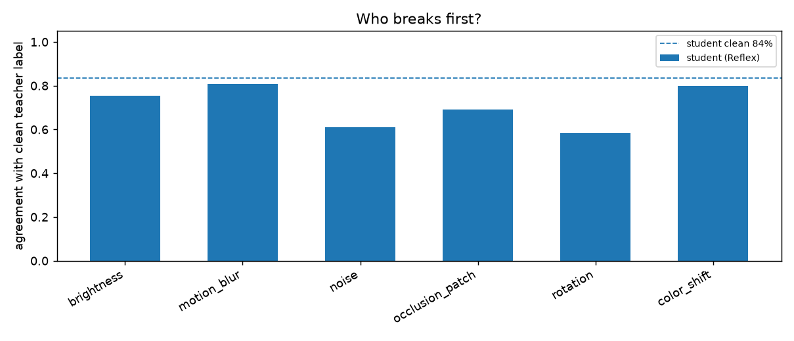
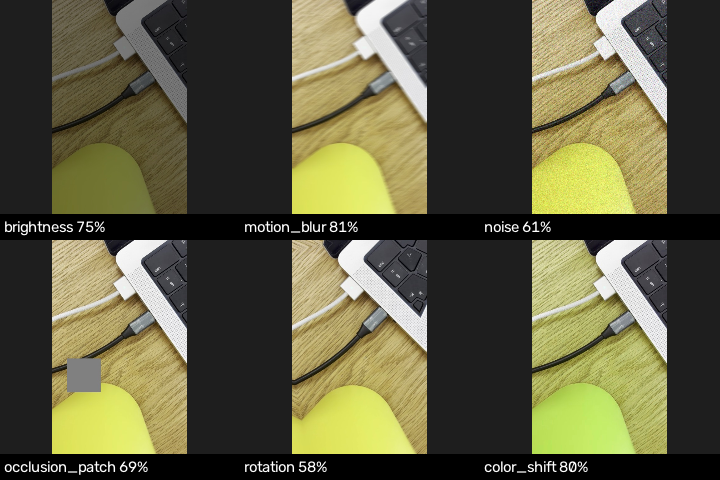

# Reflex stress test — `plug`

Clean agreement: **83.6%** on 110 test frames. Plan: default.

| perturbation | params | why | student | drop | teacher |
|---|---|---|---|---|---|
| brightness | {'factor': 0.5} | dimmer venue lighting | 75% | +8% | — |
| motion_blur | {'length': 15.0, 'angle': 0.0} | fast movement | 81% | +3% | — |
| noise | {'std': 20.0} | cheap webcam sensor noise in low light | 61% | +23% | — |
| occlusion_patch | {'size': 0.25} | something partly in the way | 69% | +15% | — |
| rotation | {'degrees': 10.0} | camera mounted slightly differently | 58% | +25% | — |
| color_shift | {'hue': 15.0, 'saturation': 1.0} | different light colour | 80% | +4% | — |

## Suggestions

- record with the camera tilted a few degrees (agreement drops 25% under rotation)
- record in low light with the demo camera (agreement drops 23% under noise)
- record with partial occlusions (hands, objects in the way) (agreement drops 15% under occlusion_patch)
