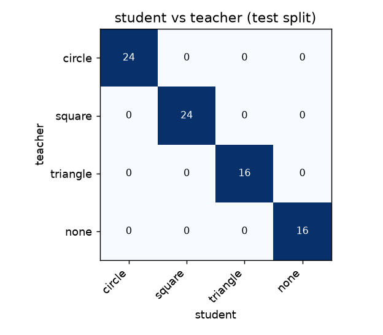

# Reflex report — `shapes`

**Task:** Identify the single filled shape on the screen.  
**Query:** what shape is on screen?  
**Classes:** circle, square, triangle, none  
**Backbone:** mobilenetv3_small_100

## Student vs teacher

| | Student (Reflex) | Teacher (cloud) |
|---|---|---|
| Agreement with teacher | **100.0%** (macro-F1 1.00) | — |
| Latency p50 / p95 | **5.5 / 7.8 ms** (CPU, onnxruntime) | 421.1 / 514.7 ms (+ network) |
| Speed-up | **76.9×** | 1× |
| Size | **6.11 MB** | — |
| Cost per 1,000 frames | **$0** | $None |

Test set: 80 frames, split by **episode** (no random frame split → no leakage).
Agreement on frames where the teacher was confident (≥ 0.6): 100.0%.

## Per class

| class | precision | recall | support |
|---|---|---|---|
| circle | 1.00 | 1.00 | 24 |
| square | 1.00 | 1.00 | 24 |
| triangle | 1.00 | 1.00 | 16 |
| none | 1.00 | 1.00 | 16 |

